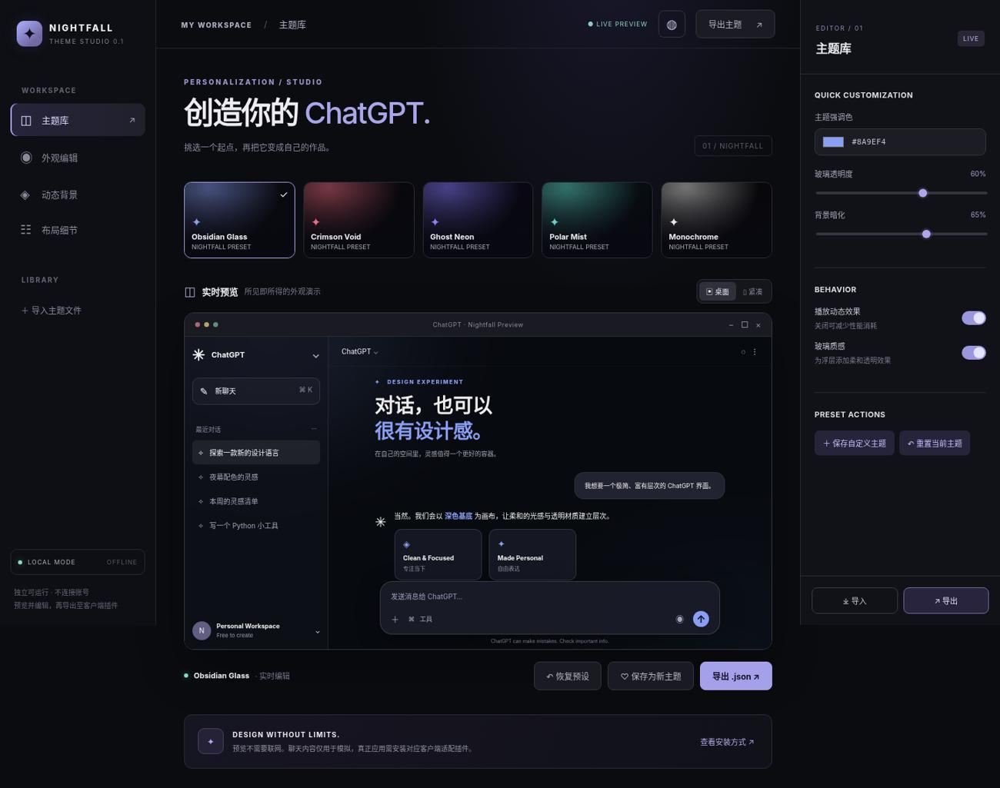

# Nightfall Theme Studio · v0.4.0

> **Windows ChatGPT 换肤工具（实验版）**。深黑 OLED、动态背景、自选图片/视频、魔导书启动动画。免费、本地运行，不需要 API Key。**非 OpenAI 官方项目**。



## 🎯 现在怎么用？

**以前**：打开预览 → 导出 JSON → 找目录 → 复制插件 → 重新导入。非常繁琐。

**v0.4**：启动主题管理器 → 选皮肤 / 上传背景 → **「一键应用到 ChatGPT」**。图片、视频不用再为了 5MB 的人为限制压缩。

### Windows 使用步骤

1. 下载本仓库，解压到你喜欢的位置。如果使用仓库源代码方式，需要安装 **Python 3**（仅用 Python 标准库）；GitHub Actions Windows 构建产物提供无需 Python 的独立 EXE（未经代码签名，需自行确认来源）。
2. **双击根目录 `安装并启动Nightfall.bat`**。浏览器会自动打开本机主题管理器。
3. 主题库任选皮肤；选择「动态背景」可上传本地图片或视频。
4. 点击 **「✦ 一键应用到 ChatGPT」**。首次会自动尝试安装 Nightfall 主题插件。若显示「运行时未安装」，按下面的兼容说明处理。
5. 已装好兼容运行时并加载了 Nightfall 的客户端：返回桌面 ChatGPT，通常无需手动导入 JSON；若没生效，尝试彻底退出重启客户端。**是否适配你的官方客户端版本仍需 Windows 实机验证。**
6. 不喜欢就点 **「恢复官方外观」**，也可以运行 `desktop-scripts/uninstall.ps1` 删除 Nightfall 插件。

### ⚠️ 必须说明的 Windows 官方客户端限制

OpenAI 的 Windows 官方 ChatGPT 客户端**没有公开的完整换肤扩展接口**。Nightfall 不是一个能绕过此限制、直接修改官方客户端的工具。Windows 桌面换肤依赖用户**自行安装并信任**一个兼容的第三方注入运行时，例如 [ChatGPT++](https://github.com/Shunlly/chatgpt-plusplus)；这类项目并非 OpenAI 发布，且其对不同 ChatGPT / Codex 版本的兼容性并不保证。Nightfall 不会在后台默默下载、运行第三方补丁，也不会修改 Windows 系统保护设置。

- **未安装运行时**：主题管理器可正常选皮肤、上传背景和预览，但「应用到客户端」会清楚提示未连接，**不会假报成功**。
- **已有可用运行时**：点一次「应用」，Nightfall 自动把插件安装进该运行时，并写入皮肤配置。插件若已在官方客户端加载，会轮询配置并热更新；**只是写入配置不等于已经验证外观生效**。
- **浏览器 ChatGPT**：可用 `extension/` 的 Chrome / Edge 扩展进行网页换肤。需要首次手动在「开发者模式」加载扩展。

## 🖼️ 自定义图片 / 视频

- 图片通过 `image/*` 选择器选择；视频通过 `video/*` 选择器选择。常用 PNG/JPG/WEBP/AVIF、MP4/WEBM 可用。GIF 等格式能否动起来，取决于浏览器解码。
- **移除了旧的 5MB / 9MB 人为限制**。主题设计器使用 IndexedDB 保存文件 Blob，预览使用 Object URL，不再将媒体塞进只有几 MB 的 localStorage。
- 使用一键应用时，本机桥接工具会**逐块**复制媒体到插件专属数据目录，插件逐块读取再转成本地 Blob URL。支持超过旧上限的较大素材，不将视频编码进 JSON。
- 但**不是无限大保证**：实际大小仍受本地磁盘、Chromium 可用内存、视频编码器与设备性能限制。非常长的 4K 视频可能卡顿；优先选 H.264 MP4 / VP9 WebM。对于不兼容编码，工具不会替你转码。
- 素材仅保存在当前电脑；**导出的主题 JSON 不携带大型媒体数据**，共享主题时需单独附媒体文件。在其他电脑导入后重新选择素材即可。
- 背景和配置不会上传到云端；本机服务仅绑定 `127.0.0.1`，会校验网页请求来源，关闭命令行窗口即可停止服务。

## ✅ 已实现功能

- 6 套预设：Obsidian Glass、Crimson Void、Ghost Neon、Polar Mist、Monochrome、Anti-Magic Grimoire
- 动态极光、星点、渐变、自定义图片/视频背景；颜色、透明度、布局精调
- 月蚀、星尘、科技信号、魔导书觉醒 4 种可跳过的**渲染后**启动动画；不替换 Windows 原生 splash screen
- 本地主题存储、导出/导入 JSON、一键尝试安装插件与应用、恢复默认外观
- 可选的 Chrome / Edge 网页版插件

## 故障排查

| 现象 | 说明和处理 |
| --- | --- |
| 双击无反应 | 使用源代码包时检查 Python 3 是否安装、`py -3 --version` 是否能运行；不要直接双击 `studio/index.html` 来使用客户端应用功能。 |
| 状态显示「离线预览」 | 正在直接打开 HTML 文件；请通过根目录 BAT 启动。 |
| 状态显示「桌面运行时未安装」 | 官方客户端没有公开换肤 API；请自行评估兼容第三方运行时的安装风险。未安装时不会强行注入。 |
| 点击「应用」后聊天界面没变化 | 检查插件是否被兼容运行时真正加载；重启客户端。提供 Windows 应用版本、Nightfall 界面状态截图协助排查。 |
| 大视频卡顿、黑屏 | 不是文件大小开关问题，可能是磁盘、解码格式、显存/内存不足；可转 H.264 MP4 或改静态图。 |
| 主题切换后背景丢失 | 重新选择图片/视频；文件存放于浏览器 IndexedDB，浏览器清站点数据会清掉素材缓存。 |
| 要卸载 / 还原 | 点「恢复官方外观」或执行 `powershell -File desktop-scripts/uninstall.ps1`；如果第三方运行时损坏，依运行时自身流程修复。 |

## 📁 项目目录

```text
安装并启动Nightfall.bat    ← Windows 推荐入口
start-studio.bat           ← 与上面相同的本地启动方式
studio/                    ← 可视化主题编辑器
shared/                    ← CSS / Canvas 动效引擎
desktop-scripts/bridge.py  ← 本地 HTTP 服务 / 主题应用 / 分块媒体存储
desktop-tweak/             ← 实验性 Windows 渲染层插件
extension/                 ← 浏览器 ChatGPT 扩展
themes/                    ← 主题配置示例
tests/                     ← 测试
```

## 🔧 开发验证

不依赖第三方 Python 库：

```bash
python desktop-scripts/build.py
python -m unittest discover -s tests -p 'test_bridge.py' -v
node --test tests/engine.test.cjs
# 可选：pip install playwright; python tests/smoke_ui.py
```

**安全边界**：不修改 ChatGPT 官方程序包、不使用开发者密钥、不监视或保存聊天内容、不打开公网监听地址。第三方插件运行时可能有额外风险，需要用户自己判断和确认。运行时兼容性、Windows 原生启动画面更改并非 v0.4 已实现能力。

MIT License · Unofficial project; not endorsed by OpenAI.
