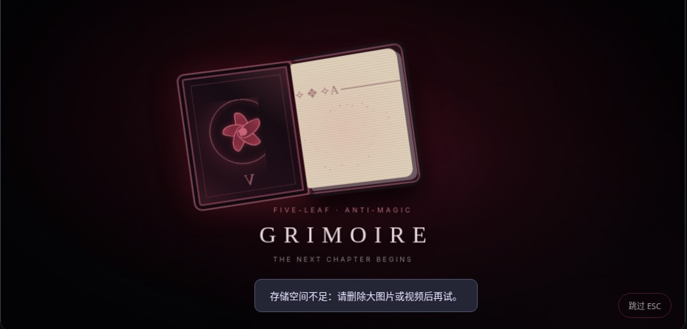

# ✦ Nightfall Theme Studio

> ChatGPT 的另一个夜晚。OLED 深色、玻璃材质、动态背景和独立主题编辑器。**非 OpenAI 官方项目**。


## 当前版本：v0.3.0（魔导书主题联动）

- ✅ **离线主题设计器**：打开 `studio/index.html`，立即看到实时聊天界面预览（只用于设计，不发送消息）。
- ✅ **6 款预设**：Obsidian Glass、Crimson Void、Ghost Neon、Polar Mist、Monochrome、Anti-Magic Grimoire。
- ✅ **个性化**：调色板、玻璃透明度、遮罩、圆角、字号、对话宽度、紧凑布局。
- ✅ **启动动画**：月蚀光环、星尘凝聚、科技信号 4 种风格（新增魔导书觉醒）；支持自定义文字、时长、播放频率、ESC 跳过、实时预览。
- ✅ **动态背景**：极光、星点粒子、渐变、自定义图片、视频（MP4/WEBM）、关闭动画。
- ✅ **皮肤文件**：JSON 导入/导出，离线本地保存自定义主题。
- ✅ **Chromium 浏览器扩展**：作用于 `chatgpt.com`（Manifest V3），可以读取 Nightfall JSON 并更改网页外观。
- 🧪 **Windows 桌面客户端实验性适配**：提供 ChatGPT++ 风格 renderer tweak，不修改会话内容或业务逻辑。**未在用户 Windows 官方 ChatGPT 客户端上验证，不能保证兼容。**
- ✅ **恢复**：关闭扩展/禁用 tweak 即可撤销本项目样式，提供独立卸载脚本。

## V0.3 魔导书主题与启动联动



在「主题库」选择 **Anti-Magic Grimoire**，会同时设定暗红色风格、低速背景星点、**Grimoire 魔导书觉醒**开场动画（默认 2.8 秒）。可点「▶ 预览启动」随时播放：五叶草纹章古书出现、翻开封面、暗红色反魔法星屑溢出，渐隐露出聊天预览。动画由 HTML/CSS 画出，不需要下载任何素材，也不会连接外部网站；可以按 ESC 或点击「跳过」关闭。

这是以《黑色五叶草》氛围为灵感的**非官方粉丝向原创 UI 设计**，不包含原作图片/徽标，也没有音频。切换到其它主题则恢复其各自的启动动画预设。导出的 JSON 会保留每套皮肤自己的 `introStyle` / `introName` / `introDuration`。

**已知限制**：启动动画运行在客户端网页渲染层之后，不替换 Windows 原生 splash screen。

## 30 秒体验

1. 下载项目 ZIP 并解压。
2. 在 Windows 资源管理器中双击 `start-studio.bat`，或直接打开 `studio/index.html`。
3. 在左侧选主题，右侧调参数；切到「启动动画」可以预览开屏，再点击“导出 .json”保存主题。
4. 如需真正应用，请按下面选择一种适配方式。

## 使用方式 1：浏览器 ChatGPT（可用路径，推荐先验收）

1. 在 Chrome/Edge 打开 `chrome://extensions/` 或 `edge://extensions/`。
2. 开启“开发者模式”并选择“加载已解压的扩展程序”。
3. 选择本项目 `extension/` 文件夹。
4. 打开 `https://chatgpt.com/`，点工具栏 Nightfall 图标，选预设或导入刚才导出的 JSON。
5. 关闭扩展的“主题效果”即可恢复官方网页样式，无需触碰官方应用文件。

浏览器扩展只有 `storage` 权限，只在 `chatgpt.com` 页面加载。项目不包含分析、遥测、网络请求，也不读取聊天文本。

## 使用方式 2：Windows 官方桌面客户端（实验性）

**重要限制：官方 Windows ChatGPT 客户端目前没有公开的完整主题注入 API。这里的 renderer tweak 需要单独安装第三方补丁/运行时才能尝试加载，例如 ChatGPT++。是否能作用于你安装的具体 ChatGPT Windows 客户端构建，尚待本机验证。**

此项目不会提供未经核实的一键补丁，也不建议关闭杀毒软件或绕开客户端完整性检查。安装第三方运行时前请自行阅读它的权限、代码和风险说明。

1. 预先安装并确认可工作的适配运行时，例如 https://github.com/Shunlly/chatgpt-plusplus （*第三方项目，风险自负，目标兼容性须验证*）。
2. 安装好运行时后，在 PowerShell 执行本项目 `desktop-scripts/install.ps1`（或手动复制 `desktop-tweak/manifest.json` 和 `desktop-tweak/index.js` 到 `%APPDATA%\chatgpt-plusplus\tweaks\nightfall-theme-studio\`）。
3. 重新加载 tweaks 或重启被该运行时支持的客户端，在其扩展设置中找到 **Nightfall Studio**。
4. 导入主题文件、切换预设，或直接在插件页调整颜色和尺寸。
5. 要卸载：关闭客户端，执行 `desktop-scripts/uninstall.ps1`，再重新打开。脚本只删除 ID 匹配的 Nightfall tweak 文件夹。

*提示：Nightfall 仅提供视觉覆盖层，不保证每一个原生窗口、标题栏、菜单都会改变。Electron/WebView/Codex 的运行环境可能不同，选择器需要随宿主版本适配。*

## 项目结构

```text
Nightfall_Theme_Studio/
├── studio/               离线主题设计器，可直接打开 index.html
├── shared/engine.js      主题数据规范 / CSS / 动态背景引擎
├── extension/            Chromium MV3 浏览器扩展（含打包好的 content.js）
├── desktop-tweak/        实验性 renderer 插件（含打包好的 index.js）
├── desktop-scripts/      构建脚本 + Windows 插件安装 / 卸载
├── tests/                Node.js 内核测试 + 浏览器 UI 冒烟测试
├── themes/               预置的示例主题 JSON
└── docs/                 产品边界与 UI 预览
```

## 开发与构建

不需要服务器、不需要 API key、不需要 npm 依赖，也不需要上传账号信息。

```bash
python desktop-scripts/build.py    # 将 shared/engine.js 与适配脚本打包为单文件
node --test tests/engine.test.cjs  # 测试主题数据验证和 CSS 安全边界
```

更改 `shared/engine.js`、`desktop-tweak/adapter.js` 或 `extension/adapter.js` 后需要重新运行 build 脚本。`desktop-tweak/index.js` 和 `extension/content.js` 已在项目包里，可直接安装。

## 数据与安全边界

- 所有皮肤配置都在本地处理；主题 JSON 可能包含 Base64 背景素材，分享前请检查隐私内容。
- 背景图片和视频限定格式与大小；HTML/CSS 动态样式使用校验后的颜色和数值，用户 JSON 不作为可执行代码运行。
- 当前版本**不支持任意用户 CSS/JS 注入**，这是有意的安全约束；未来高级模式需要独立隔离和权限设计。
- 预览只模拟聊天 UI，不提供真实聊天交互。
- 针对客户端升级，外观选择器可能部分失效。遇到兼容问题应先禁用 Nightfall，保留原始客户端功能。

## 计划

- [ ] 针对真实 Windows ChatGPT 官方客户端做构建号兼容性测试
- [ ] 更细致的动效时间轴、可编辑的关键帧、GIF/WebM 自定义开场
- [ ] 更完整的设置窗口、消息卡片和原生弹窗适配
- [ ] 主题市场（离线 JSON 导入优先）
- [ ] 主题包图片资源的自动压缩 / 空间统计

## 授权

MIT License。非官方项目，不代表 OpenAI 或 ChatGPT 客户端团队。

## 启动动画的技术边界

Nightfall 的启动动画是**renderer 渲染后叠加的全屏过渡层**，适用于离线预览与可用的 renderer tweak 运行时。它无法修改 Windows 官方 ChatGPT 客户端真正的原生启动屏、加载顺序、系统窗口或登录流程。第三方运行时在用户 Windows 构建上的兼容性尚未验证。

默认按窗口会话展示一次，用户可选每次渲染器加载都展示。动画在减少动态效果模式下自动跳过；ESC 或点击「跳过」能立即关闭。
